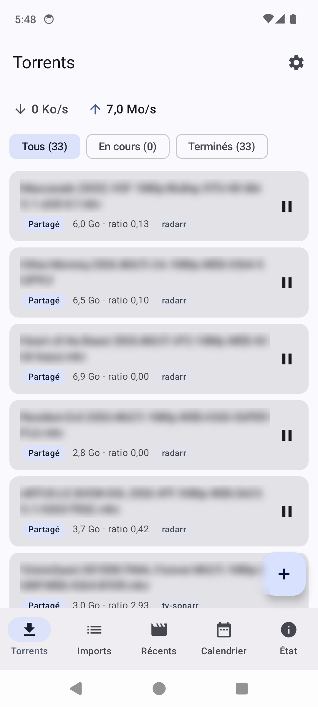
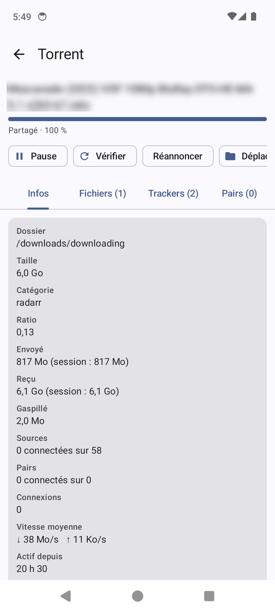
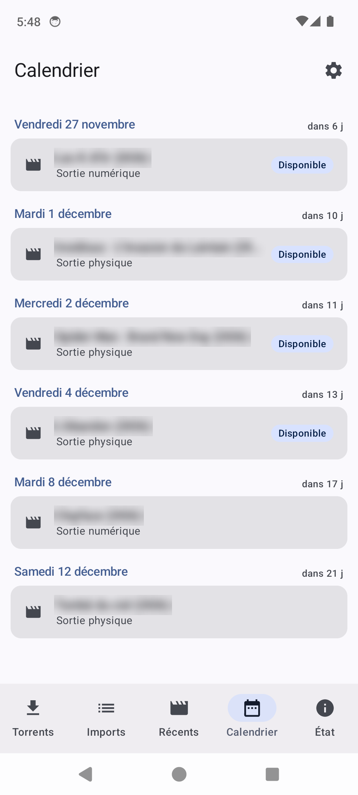
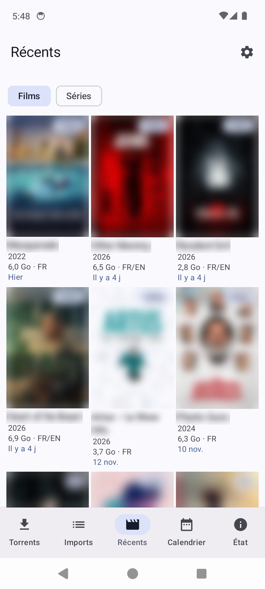
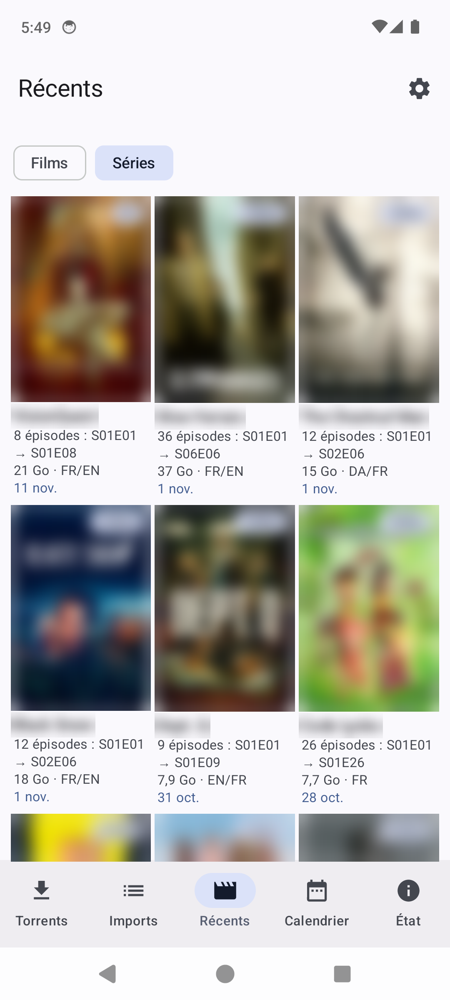
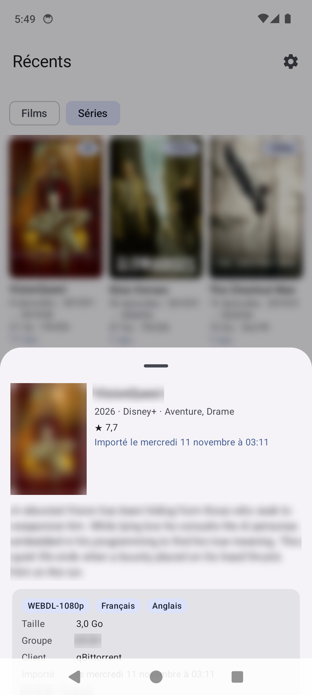
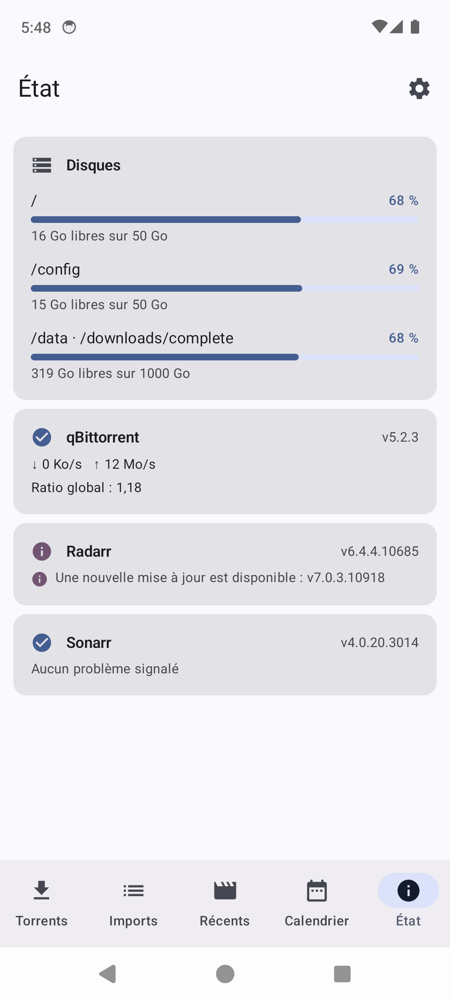
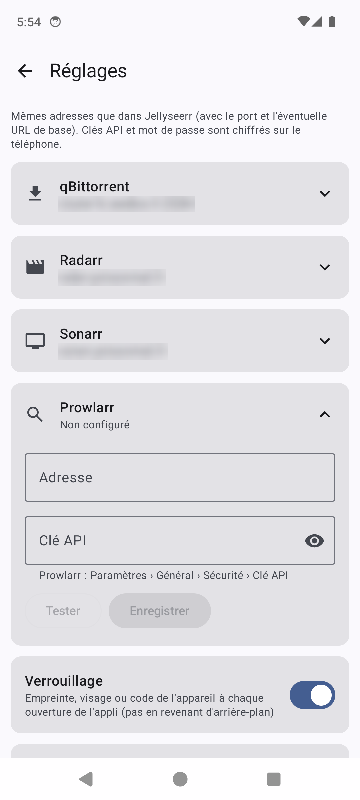
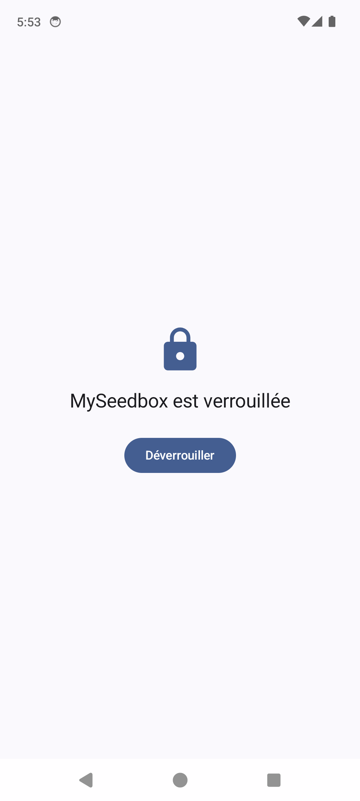

# MySeedbox

Appli Android pour suivre et piloter sa seedbox, quel que soit l'hébergeur (seedbox louée, serveur dédié, VPS ou NAS à la maison) : **qBittorrent**, **Radarr**, **Sonarr** et **Prowlarr**. Il suffit que ces services soient joignables depuis le téléphone.

Les demandes de films et séries restent dans un outil dédié comme Jellyseerr ou Overseerr ; cette appli s'occupe de ce qui se passe ensuite.

## Fonctionnalités

- **Torrents** (qBittorrent) : vitesses globales, liste des torrents avec progression, état, ratio et temps restant, filtres (en cours, terminés, erreurs), pause/reprise et suppression (avec ou sans les fichiers). Actualisation toutes les 5 s.
- **Fiche d'un torrent** : pause/reprise, vérification, réannonce, déplacement vers un autre dossier, suppression ; onglets Infos, Fichiers (cocher/décocher pour télécharger ou non), Trackers et Pairs.
- **Ajout de torrents** : lien magnet, URL ou fichier `.torrent`, avec catégorie et dossier de destination choisi en parcourant le serveur. L'appli s'ouvre aussi depuis un lien magnet, un fichier `.torrent` ou le menu « Partager ».
- **Imports** : files d'attente de Radarr et Sonarr réunies (progression, état de l'import, messages d'erreur ou d'avertissement).
- **Récents** : derniers films (Radarr) et dernières séries (Sonarr) importés, en grille avec pochette ; une carte par série avec les épisodes arrivés, la qualité, la taille, la langue et la date d'import. Toucher une carte ouvre sa fiche : genres, durée ou chaîne, note, résumé, et pour chaque release téléchargée la qualité, les langues, les formats personnalisés, la taille, le groupe, le client, l'heure d'import et le nom de la release (copiable).
- **Calendrier** : épisodes et films attendus sur 30 jours, groupés par jour, avec une coche quand le fichier est déjà là.
- **État** : version et santé de chaque service, espace disque (Radarr/Sonarr), espace libre et ratio global (qBittorrent), indexeurs actifs ou en échec (Prowlarr).
- **Réglages** : adresse, clé API (ou identifiants qBittorrent) et bouton « Tester » pour chaque service. Les secrets sont chiffrés avec une clé du Keystore Android et ne sont jamais dans le code.
- **Verrouillage** (activé par défaut) : empreinte, visage ou code de l'appareil à chaque ouverture de l'appli. Une fois déverrouillée, elle le reste tant qu'elle est ouverte, même réduite ; il faut la fermer complètement pour qu'il soit redemandé. Sans verrouillage d'écran sur le téléphone, il est inactif.
- **Sauvegarde** : export de toute la configuration dans un fichier chiffré par un mot de passe (AES-256-GCM, clé dérivée par PBKDF2), à enregistrer sur Google Drive ou ailleurs, puis import sur un autre téléphone. Le mot de passe n'est enregistré nulle part : sans lui, la sauvegarde est inutilisable.

Chaque service est facultatif : seuls les onglets des services configurés affichent des données, et un service en panne n'empêche pas les autres de s'afficher. Tirer vers le bas pour actualiser un écran.

## Captures

Titres, pochettes, noms de release et adresses sont floutés.

| Torrents | Fiche d'un torrent | Calendrier |
|:---:|:---:|:---:|
|  |  |  |
| **Récents : films** | **Récents : séries** | **Récents : fiche** |
|  |  |  |
| **État** | **Réglages** | **Verrouillage** |
|  |  |  |

## Prérequis

- qBittorrent avec la WebUI activée (v4 ou v5 ; le choix du dossier de destination demande la v5).
- Radarr et Sonarr (API v3), Prowlarr (API v1).
- Une adresse joignable depuis le téléphone : domaine public de l'hébergeur, reverse proxy, ou VPN (Tailscale, WireGuard…) pour un serveur à la maison. HTTPS conseillé.

## Configuration

Pour chaque service, l'adresse complète avec le port, par exemple `https://ma-seedbox.exemple.com:8080`, ou derrière un reverse proxy `https://ma-seedbox.exemple.com/radarr` (ajouter l'URL de base si le service en a une). Si `https://` est omis, il est ajouté automatiquement.

- Radarr, Sonarr, Prowlarr : clé API dans Paramètres › Général › Sécurité.
- qBittorrent : utilisateur et mot de passe de la WebUI.

## Installation

APK de test toujours à jour : [MySeedbox-debug.apk](https://github.com/florianfish/MySeedbox/releases/download/debug/MySeedbox-debug.apk). Les versions publiées sont dans les **Releases**. Android 8.0 minimum.

## Build

CI fournie par [Forge-Apk](https://github.com/florianfish/Forge-Apk) : APK de debug à chaque push et PR, release signée sur un tag `v*` ou via le bouton « Run workflow » (secrets `KEYSTORE_BASE64`, `KEYSTORE_PASSWORD`, `KEY_ALIAS`, `KEY_PASSWORD`).

En local : Gradle 9.9.1, JDK 17, SDK Android 37, puis `gradle assembleDebug`.
